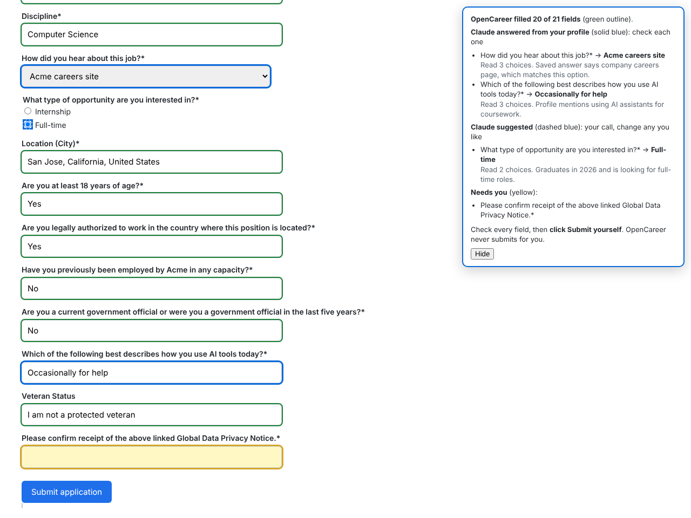
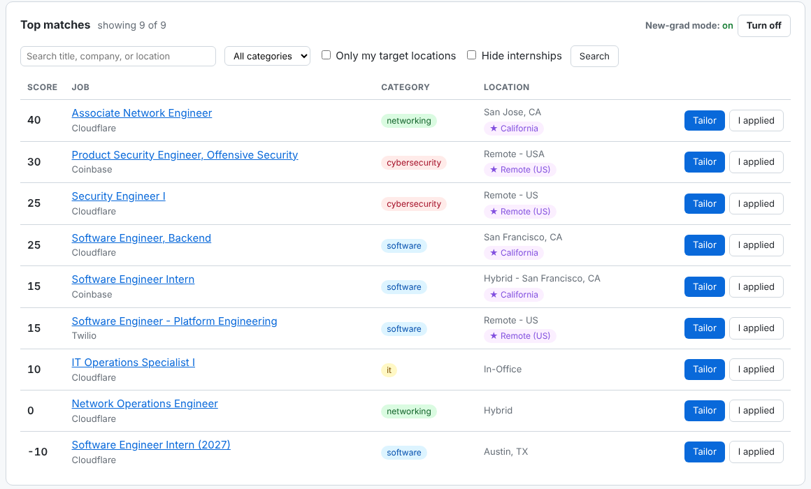
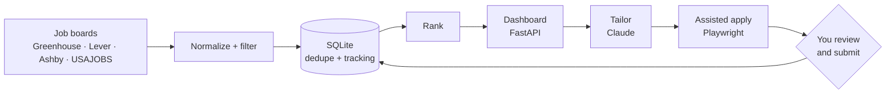

# OpenCareer Agent

A personal job-search assistant that runs on your own computer. It finds entry-level software engineering, cybersecurity, networking and IT jobs from public job boards. It ranks them by verified deadline and fit, and uses Claude to tailor your resume and cover letter for each one. Then it opens the real application in Chrome and fills in the form for you to review.

**It never submits anything.** You check every field and click Submit yourself.

Built in Python with FastAPI, SQLite, Playwright and the Anthropic API.


*Assisted apply on a practice form (fictional applicant). The panel explains every answer Claude chose.*


*Ranked matches from public job boards.*

---

## What it does

| | |
|---|---|
| **Finds jobs** | Pulls live postings from Greenhouse, Lever and Ashby boards (no keys needed) and from USAJOBS (free key). Keeps entry-level roles in four categories: software, cybersecurity, networking and IT. |
| **Ranks them** | Scores each job on relevance, how soon its *verified* deadline is, how new it is, and your target locations (California first, for example). Senior roles are filtered out; in new-grad mode, new-grad roles move up and internships move down. |
| **Dedupes and tracks** | Stores every job once in SQLite. Tracks what you've applied to, plus follow-ups, interviews and outcomes. |
| **Tailors** | Claude rewrites your best-matching resume and writes a cover letter for the specific posting, using only facts from your profile and resumes. It also adds notes on anything you should double-check. |
| **Uses your GitHub** | Reads your public repos and drafts resume project entries from what each repo actually shows. You edit them, and they're added to your profile only when you approve. |
| **Pre-fills applications** | Opens the real form in Chrome, fills what it's sure of, uploads your PDFs, and highlights what's left for you. |
| **Autopilot** | Optional daily run that finds new jobs, tailors the top few, and sends you a Mac notification. It never applies. |

---

## How assisted apply works

Click **Prepare application** on a job and a Chrome window opens on the real form.

1. **Your profile first.** Name, contact info, address, education, work history, work authorization and similar fields come straight from `profile.yaml`.
2. **Your past answers.** After you submit an application, OpenCareer remembers your answers to repeated questions (like "How did you hear about us?") for next time.
3. **Claude, one dropdown at a time.** For each dropdown still empty, the agent:
   - opens it and reads every choice;
   - has Claude pick the one that's true for you, or skip it;
   - clicks the chosen answer, then moves to the next.

   Claude has to pick one of the exact choices on the page. Anything else is thrown away.
4. **You.** Agreements, legal questions and eligibility questions are never filled automatically.

The panel in the corner shows what happened, color-coded:

| Outline | Meaning |
|---|---|
| 🟩 Green | Filled from your profile or your past answers |
| 🟦 Solid blue | Claude answered from your profile; its reason is shown |
| 🟦 Dashed blue | Claude's *suggestion* for a preference (team, focus area); your call |
| 🟨 Yellow | Needs you |

**Safety rules built into the code:**
- It never clicks a submit button.
- While filling, the form is locked so nothing can submit it, not even a stray Enter key.
- It detects the "Thank you for applying" page after *you* submit, then marks the job as applied.

On a real Greenhouse application (Coinbase), it filled 33 of 37 fields. The fields left for the applicant included the two agreements and an eligibility question, as designed.

---

## Setup

You need: macOS (the dashboard runs anywhere, but the daily autopilot uses macOS scheduling), **Python 3.11+**, **Google Chrome**, and an **Anthropic API key** ([console.anthropic.com](https://console.anthropic.com)).

```
git clone https://github.com/cjgamez12/OpenCareer-Agent.git OpenCareer_Agent
cd OpenCareer_Agent
python3 -m venv .venv
source .venv/bin/activate
pip install -e ".[dev]"
```

If Chrome isn't installed, Playwright can use its own browser instead:

```
playwright install chromium
```

### API keys

Create a file named `.env` in the project folder. Don't put quotes around the values.

```
ANTHROPIC_API_KEY=sk-ant-...
USAJOBS_API_KEY=your-usajobs-key
USAJOBS_EMAIL=you@example.com
```

Then make it readable only by you:

```
chmod 600 .env
```

The two USAJOBS lines are optional; without them, federal jobs are skipped. You can get a free key at [developer.usajobs.gov](https://developer.usajobs.gov).

In the Anthropic Console, set a monthly spending limit. Normal use costs a few cents per tailored job.

### Your profile

Put your resumes (PDF or Markdown) in the `profile/` folder. Then open the **Profile** page in the dashboard, where Claude can draft `profile/profile.yaml` from your resumes. Read it and fix anything it got wrong.

The parts that fill application forms look like this (example values):

```yaml
name: "Alex Rivera"
email: "alex@example.com"
phone: "555-010-0000"
links:
  linkedin: "https://www.linkedin.com/in/example"
  github: "https://github.com/example"

preferences:
  willing_to_relocate: true
  needs_sponsorship: false

education:
  school: "University of California, Berkeley"
  degree: "B.S. in Computer Science"
  discipline: "Computer Science"
  graduation: "2026-06"

experience:
  - title: "IT Support Technician"
    org: "Campus IT"
    dates: "2024-09 to 2025-06"

application_answers:
  work_authorized_us: true
  over_18: true
  start_date: "Immediately"
  how_did_you_hear: "Company careers page"
  address:
    street: "123 Main St"
    city: "San Jose"
    state: "California"
    zip: "95113"
    country: "United States"
  standard_answers:
    government_official: false
    relative_of_government_official: false
    conflict_of_interest: false
  demographics:
    gender: "Decline to self-identify"
    veteran_status: "I am not a protected veteran"
```

Anything you leave out is left for you to fill on the form.

---

## Daily use

```
./start.sh
```

This opens the dashboard at http://127.0.0.1:8000. Pages update by themselves when files change.

| Page | What it's for |
|---|---|
| **Dashboard** | Ranked jobs, search, **Refresh jobs**, target locations, new-grad mode, autopilot controls |
| **Companies** | Add or remove boards (Greenhouse, Lever, Ashby); see each company's open roles and suggestions |
| **Job / draft** | Tailor, edit the resume and cover letter, export PDFs, **Prepare application** |
| **History** | Everything you've applied to and where it stands |
| **Profile** | Edit `profile.yaml`; let Claude draft it from your resumes |
| **Resumes** | View your resumes and get Claude's feedback on them |
| **GitHub** | Turn your public repos into resume project entries you approve |

A typical run:
1. **Refresh jobs**, then open one near the top.
2. **Tailor**, and read every line of the resume, cover letter and notes.
3. **Prepare application**, then check the form in Chrome, finish the yellow fields, and click Submit.

### Autopilot (optional)

Turn it on from the dashboard, or from the terminal:

```
PYTHONPATH=src python -m opencareer.autopilot --install --hour 12
PYTHONPATH=src python -m opencareer.autopilot --uninstall
PYTHONPATH=src python -m opencareer.autopilot
```

These turn on the daily run (here at 12:00), turn it off, and run it once now. Each run tailors your top new matches (5 by default) and leaves them ready for review.

---

## Privacy

Your data stays on your computer.

- **Local only.** The dashboard only listens on `127.0.0.1`, so other devices, even on your Wi-Fi, can't open it.
- **Kept out of git.** `.gitignore` covers `profile/`, `profile.yaml`, `applications/`, `*.db`, `.env` and `autopilot.log`.
- **What Claude sees:**
  - for tailoring: your resume facts (education, experience, projects, skills) and the contact details that go on a resume;
  - for a dropdown: the question, its choices, your resume facts, the names of your target locations, and your own saved answer to that same question if you have one (like how you heard about the job), so it can match the company's wording. No name or contact info.

  Claude never sees your address, your demographics or your other application answers.
- **The GitHub page** reads only your *public* repos. Claude sees their READMEs and the projects already in your profile.
- **What job sources see.** Fetching jobs sends nothing about you. Your information goes only to the company whose form you submit.
- **Turning Claude off for dropdowns.** Add `OPENCAREER_AI_PICKS=0` to `.env`.

Check everything at any time:

```
PYTHONPATH=src python -m opencareer.privacy
```

It confirms:
- your private files are ignored, and none are tracked or in the git history;
- the commit guard is on;
- `.env` is readable only by you.

**Commit guard.** Turn it on once:

```
PYTHONPATH=src python -m opencareer.privacy --install-hook
```

After that, git refuses any commit that contains your email, phone number or street address (in any file, in any format), a resume file, or a profile, database or key file.

**Keeping your data outside the project (recommended).** Point these three settings in `.env` at a folder outside the repo. Then nothing personal is inside the project folder at all:

```
OPENCAREER_PROFILE_DIR=/Users/you/OpenCareerData/profile
OPENCAREER_APPLICATIONS_DIR=/Users/you/OpenCareerData/applications
OPENCAREER_DB=/Users/you/OpenCareerData/jobs.db
```

Also turn on FileVault (System Settings → Privacy & Security) so your disk is encrypted if your Mac is lost.

**Publishing a public copy.** Keep your working repo private and publish a clean copy instead:

```
PYTHONPATH=src python -m opencareer.publish --to ~/OpenCareer_Public --email 12345678+you@users.noreply.github.com
```

It copies only committed files and scans every one for your email, phone and address, stopping if it finds any. Then it makes one fresh commit under your GitHub noreply email, so your old history and personal email stay private. Push that folder to an empty public repo. Run it again after new work, and each publish becomes a new commit.

---

## Settings

Set these in `.env` if you want to change the defaults.

| Variable | Default | What it does |
|---|---|---|
| `ANTHROPIC_API_KEY` | — | Required for tailoring and dropdown help |
| `OPENCAREER_MODEL` | `claude-sonnet-5-5` | Claude model to use |
| `OPENCAREER_AI_PICKS` | `1` | `0` turns off Claude's dropdown answers |
| `USAJOBS_API_KEY`, `USAJOBS_EMAIL` | — | Federal jobs from USAJOBS |
| `GITHUB_TOKEN` | — | Optional; raises GitHub's hourly limit for the GitHub page |
| `OPENCAREER_DB` | `jobs.db` | Database file |
| `OPENCAREER_PROFILE_DIR` | `profile` | Profile and resumes folder |
| `OPENCAREER_APPLICATIONS_DIR` | `applications` | Where drafts, PDFs and form screenshots go |

---

## Tests

```
pytest -q
OPENCAREER_BROWSER_TESTS=1 pytest -q
```

The first command runs the regular suite, with no network and no API calls. The second also drives a real browser through practice forms. They copy tricky parts of real forms: search-as-you-type school lists, dropdowns you can only click, and an "Apply" button that must never be mistaken for Submit. Every browser test also checks that nothing was submitted.

---

## Architecture



## Project layout

```
src/opencareer/
  sources/         Greenhouse, Lever, Ashby and USAJOBS adapters
  models.py        JobPosting
  filters.py       entry-level and category filters
  ranking.py       deadline, relevance and freshness scores
  pipeline.py      fetch → filter → save → rank; federal grade rules; new-grad mode
  storage.py       SQLite storage and dedupe
  tracker.py       application status and follow-ups
  locations.py     target locations
  boards.py        the companies you follow
  applicant.py     profile and resumes; what's private
  github.py        public repos → project entries you approve
  tailor.py        tailored resume and cover letter
  documents.py     PDFs
  apply.py         assisted apply: read the form, fill, highlight, remember, never submit
  ai.py            the one place that calls Claude
  autopilot.py     daily run and macOS schedule
  privacy.py       privacy check and commit guard
  publish.py       clean public copy
  web.py           the dashboard (FastAPI)
  templates/       dashboard pages
tests/             pytest suite and practice forms
```

---

## Troubleshooting

- **"No API key"**: add `ANTHROPIC_API_KEY` to `.env`, then restart `./start.sh`.
- **The form isn't found**: some company sites hide it behind an Apply button. Click Apply in the Chrome window OpenCareer opened, and it fills the form as soon as it appears.
- **A dropdown stays yellow**: see what the agent read and decided with this command (use your job's folder name):

  ```
  grep "\[dropdown\]\|\[ai\]" applications/<job-folder>/apply_log.txt
  ```

- **Federal jobs**: USAJOBS applications are submitted inside your USAJOBS account. OpenCareer opens the posting and saves your PDFs to upload.

---

## License

See [LICENSE](LICENSE).
